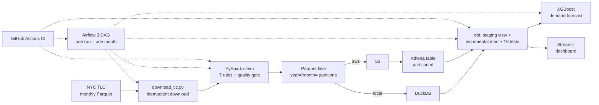

# NYC Taxi ELT Pipeline


A monthly batch pipeline for NYC TLC Yellow Taxi data. PySpark cleans each month into a partitioned Parquet lake, dbt builds and tests an hourly-demand mart, XGBoost forecasts demand per zone, and Airflow runs it end to end.

This is the batch half of my NYC Taxi Data Platform. The real-time half, [nyc-taxi-streaming](https://github.com/notparthh0/nyc-taxi-streaming), replays this pipeline's cleaned lake through Kafka into Spark Structured Streaming to detect demand spikes.

It runs two ways:

- **`local`**: the whole pipeline on a laptop, with dbt on DuckDB. No AWS account needed; this is what the tests and CI use.
- **`aws`**: the same code with the lake on S3, Athena as the query engine and dbt on Athena.

---

## Architecture



One Airflow run processes one month: `resolve_month → download_raw → spark_clean → [upload_to_s3 → register_athena_partition] → dbt_build → retrain_model → validate`. The bracketed steps only run with `PIPELINE_TARGET=aws`. Every step is idempotent, so re-running a month replaces it rather than duplicating it.

---

## Results (measured on a MacBook Air, Nov 2026)

### Cleaning

| Rule (checked in this order) | Jan 2023 removed | Feb 2023 removed |
|---|---:|---:|
| fare_amount ≤ 0 or null | 26,159 | 25,812 |
| trip_distance ≤ 0 or null | 42,225 | 37,506 |
| passenger_count < 1 or null | 114,154 | 117,987 |
| total_amount ≤ 0 or null | 0 | 0 |
| dropoff not after pickup | 63 | 75 |
| trip duration > 180 min | 2,986 | 2,872 |
| pickup outside the file's month *(new in v2)* | 41 | 53 |
| **Raw → clean** | **3,066,766 → 2,881,138** | **2,913,955 → 2,729,650** |

Rules 1–6 are the original rules: on January they still produce exactly **2,881,179** rows, the same as v1. Rule 7 is new. The raw January file contains 41 trips from other months (some as far back as October 2022), which had been giving the model a "month" feature fitted on stray rows and stretching the test window past January.

Each run writes a quality report (`data/lake/trips_cleaned/_reports/quality_<month>.json`) and **fails the run if fewer than 85% of rows survive**, so a broken upstream file stops the pipeline instead of loading quietly.

### Transformations and tests

- `trips_hourly_demand`: 65,512 zone-hours for January and 59,126 for February, from 254 pickup zones.
- `dbt build` runs 2 models and 19 data tests, including:
  - a **reconciliation test**: every cleaned trip is counted exactly once in the mart;
  - a uniqueness test on (date, hour, zone);
  - range checks on hours, weekdays, zone IDs, durations and fares.
- **Incremental by month.** A second month was backfilled with `--vars '{"month": "2023-02"}'` while January stayed untouched. Re-running a month twice gives identical totals.
- **Speed.** One month of Spark cleaning takes about 13 s. A full local Airflow run for a month (6 tasks, including retraining) takes about 23 s.

### Demand model

The XGBoost model uses only features known before trips happen (zone, hour, day of week, month) and a time-based holdout.

| Run | RMSE | MAE | R² | Mean-baseline RMSE |
|---|---:|---:|---:|---:|
| v1, January 2023 (original model) | 21.63 | 12.42 | 0.91 | 72.42 |
| v2 local retrain, Jan + Feb 2023 | 21.72 | 12.73 | 0.91 | 72.49 |

A simple "same hour last week" baseline beats this model, because the pickup zone is encoded as a number. Treating zone as a category and adding lag features is the next step for the model. These findings come from my evaluation study and are not yet applied here.

---

## Quick start (local, no AWS)

Prerequisites: Python 3.9+ and Java 17 (for PySpark).

```bash
git clone https://github.com/notparthh0/nyc-taxi-elt-pipeline.git
cd nyc-taxi-elt-pipeline
pip install -r requirements.txt

make month MONTH=2023-01                      # download → clean → dbt build + tests
make backfill MONTHS="2023-02 2023-03"        # more months, incrementally
make train-local                              # retrain XGBoost on the local mart
make test                                     # 23 tests
```

### Run it with Airflow

```bash
pip install "apache-airflow==3.0.6" --constraint \
  "https://raw.githubusercontent.com/apache/airflow/constraints-3.0.6/constraints-3.11.txt"
export AIRFLOW_HOME=$PWD/.airflow PIPELINE_TARGET=local
airflow db migrate
airflow dags test nyc_taxi_pipeline_dag -f "$PWD/orchestration/dags/nyc_taxi_pipeline_dag.py" \
  -c '{"month": "2023-01"}'
```

Without `month` in the conf, a scheduled run processes the month two months before its run date, because TLC publishes data with about that delay.

### AWS mode

```bash
cp .env.example .env    # set S3_BUCKET, S3_STAGING, S3_DATA_DIR, AWS_REGION
make dry-run-aws MONTH=2023-01                # prints the S3 plan and Athena SQL, touches nothing
export PIPELINE_TARGET=aws                    # then run the DAG as above
```

`register_athena_partition` creates `nyc_taxi.trips_cleaned_v2` (Parquet, partitioned by year/month) if it doesn't exist. It then adds only the new month's partition, which is cheaper than `MSCK REPAIR TABLE`. dbt uses the `athena` target in `transform/nyc_taxi_transform/profiles/`.

#### First-time AWS setup

1. **Permissions.** Attach `infra/iam-policy.json` to the IAM user or role the pipeline runs as, after replacing `YOUR_BUCKET`, `YOUR_REGION` and `YOUR_ACCOUNT_ID`. It allows only this bucket and the `nyc_taxi` Glue database.
2. **Locations.** Set `S3_STAGING` (Athena query results, e.g. `s3://<bucket>/athena-results/`) and `S3_DATA_DIR` (where dbt writes its tables, e.g. `s3://<bucket>/dbt/`) in `.env`.
3. **First load:**
   ```bash
   make dry-run-aws MONTH=2023-01                                 # check the plan
   python ingestion/upload_to_s3.py --month 2023-01               # S3
   python ingestion/athena_register.py --month 2023-01            # Athena table + partition
   cd transform/nyc_taxi_transform
   dbt build --profiles-dir profiles --target athena --full-refresh
   ```
   `--full-refresh` matters the first time. In v1, dbt created `trips_hourly_demand` as a view, and v2 needs to replace it with a partitioned table.
4. **Check in the Athena console.** Run `select month_key, count(*), sum(trip_count) from nyc_taxi.trips_hourly_demand group by 1`. It should match the local numbers above.
5. **Cost guard.** Set an AWS Budgets alert (e.g. $5/month). Each month is about 80 MB of Parquet, so Athena scans and S3 storage cost cents, but an alert catches mistakes.

The v1 table `nyc_taxi.trips_cleaned` and the `cleaned/` prefix are no longer used. Delete them once v2 works.

---

## Design decisions

| Decision | Why |
|---|---|
| One run = one month, partitioned `year=/month=` | Matches how TLC publishes data; reruns and backfills touch one partition only |
| First-failing-rule tagging in one Spark pass | Per-rule counts come from a single `groupBy` instead of seven separate scans |
| One canonical schema (`ingestion/schema.py`) | TLC changes column types between months; the Spark job and the Athena DDL both read this list, so they can't drift apart |
| Quality gate in the cleaning job | Bad input should fail loudly before anything is loaded |
| dbt on DuckDB *and* Athena | The same models run locally and in CI for free; the two functions that differ live in `macros/cross_db.sql` |
| Incremental mart (`insert_overwrite` on Athena, `delete+insert` on DuckDB) | Monthly runs rebuild only their month |
| `ALTER TABLE ADD PARTITION` instead of `MSCK REPAIR` | Registers one folder instead of rescanning the whole table |

## What broke along the way

- The old README listed cleaning rules the code never applied: passenger count 1–6, duration of at least 1 minute, and a January-only filter. The rules are now listed from the code, and the month filter is real.
- Airflow 3 removed `schedule_interval`, so the old DAG no longer loaded. The new one supports both Airflow 2 and 3.
- DuckDB keeps column names as they appear in the Parquet files (`PULocationID`), while Athena lower-cases them. The model crashed on the mismatch until staging aliased every column explicitly.
- The dbt project still contained the auto-generated example models and no real tests.

## Status

- **Verified locally:** the local path runs end to end and is covered by tests: Spark, the lake, dbt on DuckDB, the model, and the Airflow DAG run with `airflow dags test`.
- **Verified on AWS (14 Nov 2026):**
  - January 2023 was uploaded to S3, registered in Athena as `trips_cleaned_v2`, and built with `dbt build --target athena --full-refresh` (21/21 passed).
  - February was then added incrementally with `make aws-load MONTH=2023-02`; again 21/21 passed, and January was left untouched.
  - The Athena mart holds 65,512 zone-hours (2,881,138 trips) for January and 59,126 zone-hours (2,729,650 trips) for February, identical to the local DuckDB run.

---

## Project structure

```
ingestion/
  download_tlc.py            download one month (skips if present, atomic write)
  spark/clean_trips.py       PySpark: 7 rules, canonical schema, quality report + gate
  upload_to_s3.py            idempotent upload of one month's partition (--dry-run)
  athena_register.py         create partitioned Athena table + add the month (--dry-run)
  schema.py, common.py       shared schema and helpers
transform/
  nyc_taxi_transform/        dbt project
    models/staging/          sources.yml, stg_trips_cleaned (view)
    models/marts/            trips_hourly_demand (incremental)
    macros/cross_db.sql      Athena/DuckDB differences
    tests/                   generic tests (in_range, unique_combination) + reconciliation test
    profiles/profiles.yml    local (DuckDB) and athena targets
  xgboost_demand_model.py    DATA_SOURCE=athena|duckdb, MODEL_DIR
orchestration/dags/          Airflow 3 DAG (PIPELINE_TARGET=local|aws)
dashboard/app.py             Streamlit dashboard (reads Athena)
tests/                       pytest: cleaning rules, idempotency, dbt end to end, DAG wiring
.github/workflows/ci.yml     runs all of the above on every push
```

## Data

NYC TLC Yellow Taxi Trip Records: [nyc.gov/tlc](https://www.nyc.gov/site/tlc/about/tlc-trip-record-data.page). Zone names come from the [TLC zone lookup](https://d37ci6vzurychx.cloudfront.net/misc/taxi_zone_lookup.csv).

---

Parth Alagh · USICT, GGSIPU
