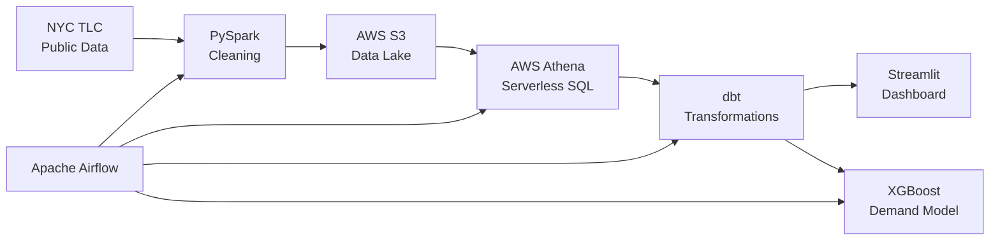

# NYC Taxi ELT Pipeline

A batch data engineering project built around the January 2023 NYC Yellow Taxi dataset.

The pipeline cleans trip records with PySpark, stores processed data in Amazon S3, queries it through Athena, transforms analytical models with dbt, and presents trip patterns in a Streamlit dashboard. An XGBoost model is included to explore demand prediction by pickup zone and hour.

---

## Architecture



The Airflow DAG orchestrates monthly runs when new TLC data is released. The dashboard and model can also be run independently.

---

## Pipeline results

| Stage | Detail |
|-------|--------|
| Raw records | 3,066,766 |
| After PySpark cleaning | 2,881,179 (6.0% dropped) |
| Weighted avg fare | $18.54 |
| Weighted avg duration | 14.5 min |
| Busiest zone | LocationID 132 (JFK Airport) — 151,831 trips |

**Cleaning rules applied:** null or zero fare, null or zero distance, passenger count outside 1–6, trip duration outside 1–180 minutes, timestamps outside January 2023.

---

## Demand model

The XGBoost model predicts hourly taxi demand per pickup zone using only features available before trips occur. Average fare, distance, and passenger count are deliberately excluded — they are derived from the trips being predicted and would cause target leakage.

| Item | Value |
|------|-------|
| Features | Zone ID, hour of day, day of week, month |
| Validation | Temporal holdout — last 20% of days |
| Train period | up to 2023-01-25 |
| Test period | 2023-01-25 to 2023-02-01 |
| RMSE | 21.63 trips |
| MAE | 12.42 trips |
| R² | 0.91 |
| Baseline RMSE | 72.42 (mean predictor) |
| Improvement | 70.1% over baseline |

Feature importance: zone ID (66%) > hour of day (21%) > day of week (8%) > month (5%).

Metrics are written to `transform/model/evaluation_metrics.json` after each training run and loaded by the dashboard at startup.

---

## Stack

| Layer | Tool |
|-------|------|
| Processing | Apache PySpark 3.5 |
| Storage | AWS S3 |
| Query engine | AWS Athena (serverless, Presto) |
| Metadata catalog | AWS Glue |
| Transformation | dbt-core + dbt-athena-community |
| ML | XGBoost, scikit-learn |
| Dashboard | Streamlit + Plotly |
| Orchestration | Apache Airflow |
| Language | Python 3.9 |

---

## Project structure

```
nyc-taxi-aws/
├── ingestion/
│   ├── spark/clean_trips.py              # PySpark cleaning job
│   └── upload_to_s3.py                   # Upload cleaned Parquet to S3
├── transform/
│   ├── nyc_taxi_transform/               # dbt project
│   │   ├── models/staging/               # stg_trips_cleaned.sql
│   │   └── models/marts/                 # trips_hourly_demand.sql
│   ├── xgboost_demand_model.py           # Demand prediction model
│   └── model/
│       ├── xgboost_demand_model.pkl      # Serialised model (gitignored)
│       └── evaluation_metrics.json       # Metrics from last training run
├── orchestration/
│   └── dags/nyc_taxi_pipeline_dag.py     # Airflow DAG
├── dashboard/
│   ├── app.py                            # Streamlit app
│   └── taxi_zone_lookup.csv              # NYC TLC zone name lookup
├── requirements.txt
└── .env.example
```

---

## Setup

**Prerequisites:** Python 3.9+, Java 17 (for PySpark), AWS account with S3 and Athena access.

```bash
git clone https://github.com/notparthh0/nyc-taxi-elt-pipeline.git
cd nyc-taxi-elt-pipeline

pip install -r requirements.txt

cp .env.example .env
# Edit .env with your S3 bucket, project root, and model paths
```

**AWS permissions required:** `s3:GetObject`, `s3:PutObject`, `athena:StartQueryExecution`, `athena:GetQueryResults`, `glue:GetTable`.

**dbt profile** (`~/.dbt/profiles.yml`):
```yaml
nyc_taxi_transform:
  target: dev
  outputs:
    dev:
      type: athena
      region_name: us-east-1
      s3_staging_dir: s3://your-bucket/athena-results/
      database: awsdatacatalog
      schema: nyc_taxi
```

**Run the pipeline:**
```bash
# 1. Clean raw data
python3 ingestion/spark/clean_trips.py

# 2. Upload to S3
python3 ingestion/upload_to_s3.py

# 3. Run dbt transforms
cd transform/nyc_taxi_transform && dbt run

# 4. Train demand model
cd transform && python3 xgboost_demand_model.py

# 5. Launch dashboard
streamlit run dashboard/app.py
```

**Known limitations:**
- The Airflow DAG requires `PROJECT_ROOT`, `S3_BUCKET`, `AWS_REGION`, and `DBT_BIN` environment variables to be set in the Airflow worker environment.
- The dataset covers January 2023 only. Multi-month analysis would require adjusting the PySpark date filters.
- The model does not account for weather, events, or public holidays.

---

## Data source

NYC TLC Yellow Taxi Trip Records — January 2023. Public dataset: [nyc.gov/tlc](https://www.nyc.gov/site/tlc/about/tlc-trip-record-data.page)

Zone names from the [NYC TLC Zone Lookup Table](https://d37ci6vzurychx.cloudfront.net/misc/taxi_zone_lookup.csv).

---

Parth Alagh · USICT, GGSIPU · 2026
